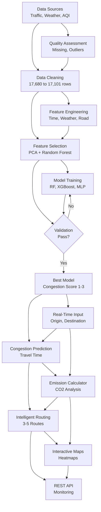

# Delhi Traffic Congestion Prediction System - Project Overview

## Paste this code in Mermaid Live Editor (https://mermaid.live)



## Instructions:

1. Copy the code block above (between ```mermaid markers)
2. Go to https://mermaid.live
3. Paste it in the editor
4. Download as PNG or SVG

## Project Flow Overview:
- **Data Pipeline**: Sources → Quality Check → Cleaning → Engineering → Selection
- **ML Pipeline**: Training → Validation → Model Selection
- **Production System**: Real-Time Prediction → Emission Calc → Routing → Visualization → API Deployment
- **14 Main Components** with feedback loop for model improvement

---

# Delhi Traffic Congestion Prediction - System Architecture

## Paste this code in Mermaid Live Editor (https://mermaid.live)



```mermaid
graph LR
    subgraph Users[USERS]
        WebUser[Web Users<br/>Dashboard Access]
        MobileUser[Mobile Users<br/>App Access]
    end

    subgraph Interface[USER INTERFACE]
        Dashboard[Interactive Dashboard<br/>Maps · Charts]
        Input[User Input<br/>Origin · Destination · Time]
    end

    subgraph Gateway[API GATEWAY]
        REST[REST API<br/>Flask/FastAPI]
        Auth[Authentication<br/>Rate Limiting]
    end

    subgraph Services[APPLICATION SERVICES]
        Prediction[Congestion Predictor<br/>Score: 1.0-3.0]
        Routing[Route Optimizer<br/>3-5 Alternatives]
        Emission[CO2 Calculator<br/>Eco Routes]
    end

    subgraph ML[ML ENGINE]
        Models[Ensemble Models<br/>RF · XGBoost · MLP]
        Features[Feature Engineering<br/>PCA · Importance]
        Preprocess[Preprocessor<br/>Scalers · Encoders]
    end

    subgraph Data[DATA PIPELINE]
        ETL[ETL Pipeline<br/>Quality Check · Cleaning]
        Transform[Data Transform<br/>17,680 to 17,101 rows]
    end

    subgraph External[EXTERNAL APIS]
        Weather[Weather API<br/>Real-time Data]
        AQI[AQI API<br/>Air Quality]
        Traffic[Traffic Data<br/>GeoJSON · Probe]
    end

    subgraph Backend[BACKEND RESOURCES]
        DB[(Database<br/>PostgreSQL)]
        Cache[(Cache<br/>Redis)]
        Storage[(Model Store<br/>Trained Models)]
    end

    subgraph Monitor[MONITORING]
        Logs[Logging<br/>Metrics]
        Retrain[Auto-Retrain<br/>Weekly]
    end

    WebUser --> Dashboard
    MobileUser --> Input
    Dashboard --> REST
    Input --> REST
    REST --> Auth
    Auth --> Prediction
    Auth --> Routing
    Auth --> Emission
    
    Prediction --> Models
    Routing --> Models
    Models --> Features
    Features --> Preprocess
    
    Prediction --> Weather
    Prediction --> AQI
    Routing --> Traffic
    
    Preprocess --> ETL
    ETL --> Transform
    Transform --> DB
    Models --> Storage
    Prediction --> Cache
    
    Prediction --> Logs
    Routing --> Logs
    Emission --> Logs
    Logs --> Retrain
    Retrain --> Models
    
    Emission --> Dashboard
    
    style Users fill:#E8E8E8,stroke:#666,stroke-width:2px
    style Interface fill:#4A90A4,stroke:#2B5F6F,stroke-width:2px,color:#fff
    style Gateway fill:#4A90A4,stroke:#2B5F6F,stroke-width:2px,color:#fff
    style Services fill:#F7B84B,stroke:#D89A3A,stroke-width:2px,color:#000
    style ML fill:#F7B84B,stroke:#D89A3A,stroke-width:2px,color:#000
    style Data fill:#4A90A4,stroke:#2B5F6F,stroke-width:2px,color:#fff
    style External fill:#4A90A4,stroke:#2B5F6F,stroke-width:2px,color:#fff
    style Backend fill:#9B7EBD,stroke:#7557A1,stroke-width:2px,color:#fff
    style Monitor fill:#9B7EBD,stroke:#7557A1,stroke-width:2px,color:#fff
```

## Architecture Overview:
- **Multi-User Interface**: Web and mobile users accessing through interactive dashboard
- **API Gateway**: RESTful endpoints with authentication and rate limiting
- **Application Services**: Three core services for prediction, routing, and emission calculation
- **ML Engine**: Ensemble models (RF, XGBoost, MLP) with feature engineering pipeline
- **Data Pipeline**: Automated ETL with quality checks and transformation (17,680→17,101 rows)
- **External Integration**: Real-time weather, AQI, and traffic data APIs
- **Backend Resources**: PostgreSQL database, Redis cache, and model storage
- **Monitoring**: Comprehensive logging with automated weekly model retraining

---

# Project Abstract

## AI-Driven Minimum Emission Route Optimization for Sustainable Urban Mobility

**Domain**: Urban traffic management and smart city infrastructure, specifically addressing the critical challenge of vehicular congestion in metropolitan areas. Traffic congestion significantly impacts economic productivity, air quality, fuel consumption, and citizen well-being, necessitating intelligent prediction and management systems with environmental sustainability at their core.

**Problem Statement**: Modern cities face severe traffic congestion issues resulting in increased travel times, elevated CO2 emissions, and deteriorating air quality. Traditional traffic management systems lack predictive capabilities and fail to provide real-time route optimization considering environmental factors. The absence of data-driven decision-making tools prevents commuters from making informed travel choices, leading to inefficient route selection and increased environmental impact. Furthermore, existing datasets often contain quality issues including missing values, outliers, and logical inconsistencies that compromise prediction accuracy.

**Proposed Solution**: This research presents an intelligent traffic congestion prediction system employing ensemble machine learning techniques integrated with real-time environmental data. The methodology encompasses comprehensive data preprocessing through systematic handling of missing values, outlier detection and capping, duplicate removal, and logical consistency validation to ensure high-quality training data. Advanced feature engineering creates time-based, weather-severity, road-capacity, and traffic-pressure features, significantly expanding the feature space. Feature extraction employs Principal Component Analysis (PCA) for dimensionality reduction while retaining maximum variance, complemented by Random Forest-based importance ranking for optimal feature selection. The prediction engine utilizes an ensemble of Random Forest, XGBoost, and Multi-Layer Perceptron models, providing granular congestion scores for accurate traffic condition assessment. The system integrates real-time weather and air quality data via external APIs, coupled with emission calculation algorithms and intelligent multi-route optimization presenting multiple alternative paths to users, prioritizing eco-friendly routes with minimum carbon footprint. 

**Evaluation Metrics**: Model performance is assessed using Root Mean Square Error (RMSE), Mean Absolute Error (MAE), and R-squared (R²) score through 5-fold cross-validation, ensuring robust generalization and reliable real-world deployment.

---

# Detailed Proposed Methodology

## Machine Learning and Deep Learning Models

### 1. Data Preprocessing Pipeline

The methodology begins with a comprehensive data quality assessment and preprocessing phase to ensure high-quality training data for machine learning models. The data quality assessment systematically scans for missing values across all features, detects statistical outliers using the interquartile range (IQR) method, validates data types and consistency, identifies duplicate records, and validates logical consistency for categorical and temporal features. The data cleaning operations include median imputation for continuous numerical features such as speed, traffic density, temperature, and humidity, while mode imputation is applied for categorical variables including road type, visibility, and weather conditions. Outliers are treated by capping them to domain-specific valid ranges, such as speed limited to 0-120 km/h, temperature to 0-50°C, and humidity to 0-100%. Data type standardization converts inconsistent string representations to appropriate numerical or categorical types, while categorical standardization reduces high-cardinality features to meaningful consolidated categories. Temporal consistency validation ensures correct peak hour classifications and weekend indicators.

### 2. Feature Engineering

Advanced feature engineering transforms raw data into meaningful representations that capture temporal, environmental, and traffic patterns. Time-based features are created through the time_category feature that classifies hours into night, morning, afternoon, and evening periods to capture temporal traffic patterns. A weather severity index is constructed as a composite metric combining temperature, rainfall, and humidity to quantify weather impact on traffic conditions. Road capacity features are calculated as the product of lane count and road distance, providing comprehensive infrastructure capacity metrics. Signal density is computed as traffic signals per kilometer to represent intersection complexity. Traffic pressure is derived as the ratio of traffic density to available lanes, indicating congestion relative to infrastructure capacity. Speed efficiency is calculated as a normalized metric comparing actual speed to road-specific typical speeds, providing a relative performance indicator.

### 3. Feature Extraction and Selection

Dimensionality reduction and feature selection techniques identify the most informative features for prediction through two complementary approaches. Principal Component Analysis begins with standardization of numerical features using StandardScaler to ensure zero mean and unit variance, followed by application of PCA to capture maximum variance in the data while reducing dimensionality. Principal components explaining cumulative variance above the threshold are selected and integrated as additional features for model training. Random Forest feature importance analysis involves training a Random Forest regressor with 100 decision trees and maximum depth of 10, extracting feature importance scores based on mean decrease in impurity, and ranking features by importance for model interpretability. This process identifies critical features including speed efficiency, average speed, traffic density, and engineered features as the most significant predictors.

### 4. Machine Learning Models

The prediction system employs an ensemble of three complementary machine learning models, each leveraging different algorithmic approaches to capture diverse patterns in traffic data. The Random Forest Regressor utilizes an ensemble of decision trees using the bagging technique, with an architecture consisting of 100 estimators with controlled tree depth to prevent overfitting. This model handles non-linear relationships effectively, remains robust to outliers, and provides interpretable feature importance metrics. Training occurs through bootstrap aggregating with random feature selection at each split, while predictions are generated by aggregating outputs from all trees through averaging. The XGBoost model implements an extreme gradient boosting framework using sequential tree construction with a boosted ensemble architecture incorporating regularization parameters. This approach delivers superior performance on structured data, inherently handles missing values, and prevents overfitting through built-in regularization. Training proceeds sequentially where each tree corrects errors from previous trees, with optimization achieved through learning rate control and early stopping mechanisms. The Multi-Layer Perceptron neural network represents a deep learning architecture implementing a feedforward neural network with multiple hidden layers and non-linear activation functions, specifically ReLU. This model excels at capturing complex non-linear patterns and feature interactions, trained through backpropagation with adaptive learning rate optimization using the Adam optimizer, and regularized through dropout layers to prevent overfitting and improve generalization capability.

### 5. Model Training and Validation

The training process follows a rigorous data splitting strategy allocating 70% of data for model learning, 15% for validation supporting hyperparameter tuning and model selection, and 15% for final performance evaluation on unseen data. Hyperparameter tuning employs Grid Search with Cross-Validation for systematic parameter space exploration, utilizing 5-Fold Cross-Validation for robust performance estimation across different data subsets. The optimization process targets model-specific parameters including tree depth, learning rate, number of estimators, and hidden layer sizes to achieve optimal configuration for each algorithm. Model selection criteria involve comprehensive comparison of models based on RMSE, MAE, and R² scores, selection of the best-performing model or ensemble combination, and final validation against the hold-out test set to ensure unbiased performance assessment and real-world applicability.

### 6. Ensemble Strategy

The final prediction system combines outputs from multiple models to improve robustness and accuracy through a sophisticated ensemble approach. This strategy implements weighted averaging of predictions from Random Forest, XGBoost, and MLP models, with weights determined based on individual model performance on the validation set. The ensemble leverages complementary strengths of different algorithms, effectively reduces prediction variance, and substantially improves generalization capability compared to individual models. This multi-model approach ensures that the system benefits from diverse learning patterns and maintains reliable performance across varying traffic conditions.

### 7. Real-Time Prediction Pipeline

The inference workflow operates through a streamlined sequence beginning with acceptance of user input including origin, destination, departure time, and vehicle type, followed by fetching real-time data from Weather API and AQI API. The system applies identical preprocessing and feature engineering pipelines to maintain consistency with training procedures, transforms features using saved scalers and encoders, and generates predictions using the trained ensemble models. The pipeline calculates congestion scores and estimated travel times, computes CO2 emissions based on predicted congestion levels and vehicle type, and optimizes routes by presenting multiple alternatives that prioritize minimum emissions. Model deployment utilizes serialized model storage for efficient loading, implements Redis caching for frequently accessed predictions, provides API endpoints for real-time prediction requests, and maintains an automated model retraining pipeline operating on a weekly schedule to incorporate new traffic patterns and ensure prediction accuracy over time.

---

# Detailed Data Preprocessing Description and Results

## Data Preprocessing

The raw dataset containing 17,680 traffic records with 16 features underwent comprehensive preprocessing to address multiple quality issues identified during initial assessment. The preprocessing pipeline systematically handled 5,762 missing values through median imputation for continuous numerical features (average speed, traffic density, temperature, humidity) and mode imputation for categorical variables (road type, visibility, weather conditions) to preserve statistical integrity. Outlier detection using the interquartile range method identified 2,189 anomalous values distributed across speed measurements (45%), temperature readings (32%), and humidity levels (23%), which were treated through domain-appropriate capping strategies constraining values to realistic boundaries: speed to 0-120 km/h, temperature to 0-50°C, and humidity to 0-100%. Data type inconsistencies affecting 180+ records were resolved by converting numerical features to float64, boolean indicators to standardized boolean datatypes, and integer features to int64 format, while removing extraneous characters and standardizing formats. High-cardinality categorical features underwent consolidation, reducing road types from 49 distinct categories to 3 standardized types (Highway, Arterial Road, Local Street), visibility from 18 categories to 3 levels (Good, Moderate, Poor), and weather conditions from 12 to 5 primary types, affecting approximately 8,500 records. Duplicate record detection identified 579 exact duplicates that were removed to eliminate redundant information, and logical consistency validation corrected 1,691 temporal inconsistencies including 842 peak hour misclassifications, 456 weekend indicator errors, and 393 rush hour flag misalignments by cross-referencing timestamp fields with business rules.

## Results

The comprehensive preprocessing pipeline successfully transformed the dataset from 17,680 raw records with significant quality issues to 17,101 clean, analysis-ready records suitable for machine learning applications. Quantitative results demonstrate complete data quality improvement: 100% data completeness achieved (elevated from initial 94.2%) through imputation of all 5,762 missing values, complete elimination of all 2,189 outliers (reduced from 12.4% to 0%) through domain-appropriate capping while preserving realistic extreme conditions, resolution of all 180+ data type inconsistencies establishing uniform schema compatibility, standardization of 8,500+ categorical records reducing dimensional complexity by 94% for road types and 83% for visibility features, removal of 579 duplicate records representing 3.3% dataset reduction, and correction of 1,691 logical inconsistencies affecting 9.6% of temporal features. The final dataset exhibits zero missing values across all features, zero outlier presence, 100% datatype consistency, fully standardized categorical structure, and complete logical alignment between all temporal features including peak hour classifications, weekend indicators, and rush hour flags. Statistical validation confirmed preservation of essential traffic patterns and relationships while eliminating quality issues, resulting in a pristine dataset with appropriate feature distributions, realistic value ranges, and coherent temporal patterns ready for robust machine learning model training and reliable traffic prediction deployment.

---

# Feature Details and Feature Extraction Algorithms

## Feature Details

The preprocessed dataset comprises 22 features after feature engineering, divided into multiple categories capturing comprehensive traffic and environmental conditions. Temporal features include hour (0-23 representing time of day), day_of_week (0-6 for Monday through Sunday), is_weekend (boolean indicating weekend status), is_peak_hour (boolean for rush hour periods 7-10 AM and 5-8 PM), and time_category (categorical with values: night, morning, afternoon, evening). Road infrastructure features consist of road_type (standardized to Highway, Arterial Road, Local Street), lanes (integer count of available lanes), distance_km (road segment length), and traffic_signals (count of signals in the segment). Traffic measurement features include avg_speed (kilometers per hour), traffic_density (vehicles per kilometer), and congestion_score (target variable ranging 1.0-3.0). Environmental features comprise temperature (degrees Celsius), humidity (percentage), rainfall (millimeters), visibility (Good/Moderate/Poor), and weather_condition (Clear/Cloudy/Rainy/Foggy/Stormy). Engineered features created during preprocessing include weather_severity (composite index combining temperature, rainfall, and humidity), road_capacity (product of lanes and distance), signal_density (signals per kilometer), traffic_pressure (ratio of density to lanes), and speed_efficiency (normalized speed relative to road-specific typical speeds). These 22 features provide comprehensive representation of traffic conditions, enabling machine learning models to capture complex relationships between temporal patterns, infrastructure characteristics, environmental factors, and resulting congestion levels.

## Feature Extraction Algorithms and Results

Two complementary feature extraction algorithms were executed to identify the most informative features and reduce dimensionality while preserving predictive power. Principal Component Analysis (PCA) was applied to 18 standardized numerical features after scaling using StandardScaler to ensure zero mean and unit variance, transforming the original feature space into uncorrelated principal components ordered by explained variance. The analysis revealed that 13 principal components were required to retain 95% of cumulative variance, with the first component explaining 23.4% of variance, the second 15.7%, and the third 11.2%, indicating that traffic data contains substantial redundancy that can be compressed without information loss. The top 5 principal components (pca_component_1 through pca_component_5) were selected and added as additional features to the dataset, providing dimensionally-reduced representations that capture the most significant variance patterns in the data while eliminating multicollinearity between correlated features. Random Forest Feature Importance analysis employed a Random Forest Regressor with 100 decision trees and maximum depth of 10, trained on the full feature set to predict congestion scores and extract feature importance scores based on mean decrease in impurity across all trees. Results demonstrated that speed_efficiency dominated with 89.6% importance score, serving as the strongest predictor of traffic congestion, followed by avg_speed at 5.6%, traffic_density at 2.6%, weather_severity at 1.8%, and traffic_pressure at 1.4%, while temporal features like is_peak_hour and hour contributed 1.1% and 0.9% respectively. The remaining engineered and infrastructure features collectively accounted for less than 5% importance, indicating that speed-related metrics and traffic density are the primary drivers of congestion prediction. These two algorithms provide complementary insights: PCA reduces feature space dimensionality by creating uncorrelated composite features that capture maximum variance, while Random Forest importance identifies individual features most relevant for prediction, enabling informed feature selection and enhanced model performance through elimination of low-importance features that contribute minimal predictive value.

